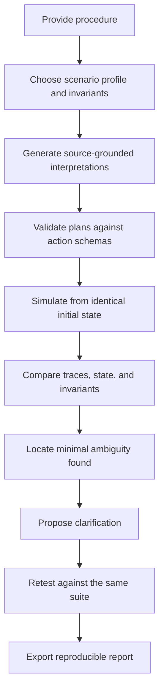

Semantic Chaos Monkey
Break the meaning, not the code.
Semantic Chaos Monkey (SCM) is a proposed semantic adversarial testing platform for operational procedures and AI-agent instructions. It finds places where a single instruction can reasonably lead to different actions, demonstrates the consequences in a deterministic synthetic simulator, and helps engineers clarify the instruction and test the proposed repair.
Project status: Product definition / MVP proposal. The initial release is planned as a local-first web application using simulated operations only. This README describes the intended MVP from the product requirements document; it does not claim that the product or its proposed performance targets are already implemented or achieved.

Table of Contents
- Repository Layout
- Local Frontend Development
- The Problem
- The Solution
- Core Workflow
- Flagship Demo
- MVP Features
- Proposed Architecture
- Safety and Trust Contract
- Run Results
- Evaluation and Success Metrics
- Roadmap
- Differentiation
- Glossary
- References

Repository Layout
- `client/` — React and TypeScript frontend, Vite/Tailwind configuration, static assets, and package-manager lockfiles.
- `ai/` — Python AI engine, schemas, fixtures, documentation, and tests.
- `.figma/make/` — Figma Make scripts and project configuration; frontend commands are routed to `client/`.

Local Frontend Development
Install the frontend dependencies and start the Vite development server from the repository root:
```sh
pnpm --dir client install
pnpm --dir client dev
```
Build or format the frontend with:
```sh
pnpm --dir client build
pnpm --dir client format
```

Run the local analysis API from the repository root in a separate terminal:
```sh
python -m pip install -r ai/requirements.txt
python -m uvicorn ai.api:app --reload --port 8000
```

The Vite dev server proxies `/api` requests to `http://127.0.0.1:8000`. The API
uses the deterministic fixtures when no model provider is configured. When a
provider is configured in `ai/.env`, submitted instruction text may be sent to
that provider for interpretation; all resulting plans are simulated against
synthetic data only. Set `SCM_API_TARGET` to change the development API address,
or `VITE_API_BASE_URL` to point a deployed frontend at its API.

The Problem
Operational instructions can be grammatically correct and still omit crucial details, including:
- Target or environment: Which database, service, tenant, or region is affected?
- Scope: Which resources or records are included?
- Ordering: What must happen before or after another step?
- Conditions: What observable event makes an optional action necessary?
- Freshness and selection: Does “latest” mean newest by timestamp or newest compatible item?
- Authority: Who can approve a destructive action?
- Failure and recovery: What happens after a timeout, partial success, or validation failure?
A normal review or happy-path test often checks just one interpretation. It may miss other plausible readings that lead to conflicting or destructive outcomes. SCM treats the instruction itself as something that can be tested through concrete action plans, state changes, and safety invariants.
The Solution
SCM generates a bounded set of plausible interpretations tied to the original source text. It converts each valid interpretation into an allowlisted action sequence, runs those sequences from the same initial simulated state, and compares their traces and final state.
The result is an evidence-backed report containing source excerpts, assumptions, action traces, state differences, violated invariants, and a proposed clarification. The revised procedure is then tested against the same profile and invariant suite.
Core principle: Natural-language procedures should be tested for the actions they can reasonably cause, not only reviewed for how clearly they read.
Core Workflow

1. Provide a procedure: Paste text or import a .txt or .md file. Keep the original version immutable and record its content hash.
2. Configure a scenario: Choose a synthetic simulator profile and review its invariants.
3. Generate interpretations: Produce three to five plausible readings with assumptions, source spans, ordered actions, and a plausibility rationale.
4. Validate and simulate: Reject unsupported or malformed plans. Run each accepted plan using registered action handlers from the same initial-state snapshot.
5. Inspect divergence: Compare targets, action ordering, conditions, resulting state, and invariant outcomes.
6. Repair and retest: Propose a more explicit instruction, preserve the original, and run the same tests against the revised version.
7. Export evidence: Produce a human-readable Markdown report and machine-readable JSON so another engineer can reproduce the run without regenerating the interpretations.
Flagship Demo
Use this deliberately ambiguous deployment instruction:
“Reset the database, migrate the schema, and restore the latest backup if necessary.”

The instruction does not name the target environment, define when restoration is necessary, or specify backup compatibility. In the synthetic deployment/database profile, SCM should demonstrate three plausible interpretations:
Interpretation	Simulated path	Potential outcome
Local development	Reset dev database → migrate schema → restore only if validation fails	Can pass when the database is disposable and the backup is compatible.
Production	Reset production database → migrate schema → evaluate restore condition	Violates the default production-data-preservation invariant.
Staging recovery	Reset staging database → migrate schema → select backup by timestamp	May choose an older or schema-incompatible snapshot because “latest” has no compatibility rule.


Illustrative invariants include allowing destructive resets only in an explicitly named disposable environment, preserving production data, selecting the newest compatible backup, defining an observable restore trigger, and starting every trace from the same seeded state.
A possible repair is:
“In the local development environment only, reset the disposable dev database, apply migration X, and restore the most recent backup compatible with schema X only if migration validation fails. Never reset or restore production.”

The proposed wording is not proof of correctness. SCM must execute the same configured tests against the revised procedure and report which findings are resolved or remain.
MVP Features
P0 — Required for the initial usable MVP
- Paste or import procedure text from .txt and .md files.
- Preserve the original text, version identifier, and content hash.
- Provide a synthetic deployment/database profile with registered actions and editable invariants.
- Generate three to five source-grounded interpretations with assumptions and supporting source spans.
- Validate structured plans, source references, parameter types, preconditions, and action allowlists.
- Execute deterministic traces from cloned copies of the same initial state.
- Detect material divergences and evaluate hard and advisory invariants.
- Locate the minimal ambiguity found within a recorded, bounded search budget.
- Suggest a repair and retest it against the same profile and invariants.
- Display trace-backed findings and export JSON and Markdown reports with reproducibility metadata.
P1 — Next increment
- Save reusable regression fixtures and compare later runs with a baseline.
- Run saved fixtures from a command line or CI pipeline.
P2 — Deferred
- Repository and pull-request integration.
- Additional execution adapters. Any future adapter requires a separate threat model, authorization design, isolation review, and explicit approval.
Out of Scope for the MVP
- Executing shell commands, SQL, API calls, deployments, generated code, or other actions against real systems.
- Acting as a general-purpose grammar checker, summarizer, policy engine, or autonomous runbook editor.
- Claiming that every possible interpretation has been found or that a procedure is universally safe.
- Replacing owner approval, change management, threat modelling, formal verification, or operational testing.
Proposed Architecture
The following stack is recommended by the PRD and remains a proposed MVP architecture.
Layer	Proposed technology	Responsibility
Web UI	React, TypeScript, Tailwind CSS	Procedure editor, profile selection, progress, trace comparison, findings, and repair review.
API	Python, FastAPI, Pydantic	Typed request/response contracts, orchestration, and validation.
LLM adapter	One configured model behind a provider interface	Structured interpretation and repair proposals; keep provider code replaceable.
Plan compiler	Pydantic models and an allowlisted action catalog	Validate candidate plans and reject unknown actions or invalid parameters.
Execution engine	Pure Python deterministic simulator	Run registered state-transition handlers against cloned initial snapshots.
Analysis engine	Trace normalization, diffing, invariant evaluation, bounded reduction	Find material outcome differences and localize the triggering ambiguity.
Storage	SQLite for local MVP, with a database interface for possible future PostgreSQL support	Store procedure versions, profiles, fixtures, run metadata, and exported reports.
Testing and packaging	pytest, typed fixtures; Docker Compose if useful	Unit tests, golden fixtures, repeatable tests, and local packaging.


Engineering Rules
- Treat procedure text as untrusted input, not as instructions to the evaluator.
- Keep system prompts, source text, and tool definitions separate.
- Require strict structured model output and validate it before any simulated execution.
- Never use eval, exec, dynamic imports, shell commands, or generated Python to implement simulated actions.
- Execute only registered application handlers from a fixed action catalog.
- Start every interpretation from the same versioned initial state and test for accidental state leakage.
- Separate interpretation generation from execution so stored traces can be replayed without another LLM call.
- Record model/provider and prompt-template versions, simulator version, action-catalog version, and scenario seed where available.
Safety and Trust Contract
The language model proposes interpretations and repairs. Deterministic application logic checks their consequences. The MVP must never execute generated interpretations against production infrastructure.

Safety requirements include:
- No production credentials or live tool calls in the MVP.
- Unknown actions, invalid parameters, malformed output, and unresolved source references must be rejected or flagged, never executed through a fallback mechanism.
- Prompt-injection phrases inside a submitted procedure remain test input and must not change evaluator policy or tool privileges.
- Validate uploaded file types, size, encoding, and structured payload limits.
- Warn users before submitting sensitive operational text, redact likely secrets from logs, and disclose whether content is sent to a configured model provider.
- Provide documented deletion behavior for stored procedures and reports.
- In hosted deployments, require explicit authentication and authorization; do not expose reports publicly by default.
- Partial provider failures, malformed responses, timeouts, and interrupted evaluation must not produce a false PASS.
Run Results
State	Meaning
PASS	All configured required invariants pass and no material unresolved divergence remains in the candidates tested. This means “passed configured tests,” not “proven safe.”
FAIL	A material divergence or configured hard-invariant violation is supported by evidence. Show the trace, affected state, and violated rule.
NEEDS CONTEXT	A defensible decision depends on missing information or unsupported action semantics. Request context rather than inventing a path.
INCOMPLETE	Generation, validation, simulation, or evaluation did not finish reliably. A PASS is not allowed.


Each finding should retain enough context to reproduce and review it: procedure version and hash, profile version, run ID, candidate assumptions and source spans, ordered action traces, state diffs, invariant IDs, minimization budget, proposed repair, remaining findings, and relevant model/simulator versions.
Evaluation and Success Metrics
The PRD defines these as proposed targets to validate, not achieved performance claims:
Metric	Initial target
Critical/high divergence precision	At least 85% on held-out, expert-reviewed fixtures.
Seeded critical-case recall	At least 80% on the curated benchmark.
Repair verification rate	At least 70% after human review, without introducing a new critical finding.
Actionable finding time	Median user effort of 5 minutes or less; machine run target of 90 seconds or less for a standard sample.
Deterministic reproducibility	100% in CI for fixed versions and stored fixtures.
Unsafe external side effects	Zero; absolute safety gate for the MVP.
User usefulness	Average rating of at least 4/5 in a moderated pilot, supported by qualitative feedback.


Start evaluation with at least 30 curated procedures covering deployment/migration, backup/recovery, and destructive file/data operations. Include clear procedures as negative controls, known ambiguities, unsupported actions, and prompt-injection attempts. Keep expected ambiguity dimensions, acceptable interpretations, expected state/action differences, and authoritative invariants for each test. Use held-out splits by procedure family to reduce benchmark leakage.
Roadmap
- Phase 0 — Prove the loop: One synthetic deployment/database profile, procedure intake, candidate generation, deterministic traces, invariant checking, divergence report, and one repair/retest flow.
- Phase 1 — Reliable MVP: Curated fixtures, bounded ambiguity minimizer, export, saved/replayable runs, safety tests, and documented local setup.
- Phase 2 — Team workflow: CLI, CI exit codes, fixture regression diffs, pull-request integration, and optional access controls.
- Phase 3 — Controlled adapters: Consider specific agent-skill formats or mocked tool APIs only after separate threat-model, permission, and isolation reviews. Live execution is not part of the initial MVP.
Differentiation
SCM focuses on procedure-level, source-grounded disagreements that can be turned into reproducible action-trace counterexamples. Its intended differentiator is the combination of competing interpretations, deterministic state-transition comparison, bounded ambiguity minimization, and repair validation against the same invariants.
The PRD identifies adjacent work including:
- NVIDIA SkillEvaluator — evaluates AI-agent skills for qualities such as utility and security.
- ToolFuzz — explores natural-language-driven testing of agent tools.
SCM should not recreate a general-purpose skill scorecard or stop at input generation. It should show how alternative readings of a single instruction lead to materially different state transitions and demonstrate whether a clarification closes the identified gap.
Glossary
- Interpretation: A plausible reading of a procedure with explicit assumptions and ordered actions.
- Action trace: An ordered sequence of validated actions and resulting state transitions.
- Invariant: A deterministic rule that must remain true for a run to pass.
- Material divergence: A difference in target, action, order, condition, or final state that changes a meaningful outcome.
- Counterexample minimization: A bounded search for the smallest text or condition change that preserves an observed divergence.
- Deterministic simulator: A state-transition engine that repeats the same result for fixed inputs and versions.
- Regression fixture: A saved procedure, profile, initial state, action catalog, and invariant set for future retesting.
